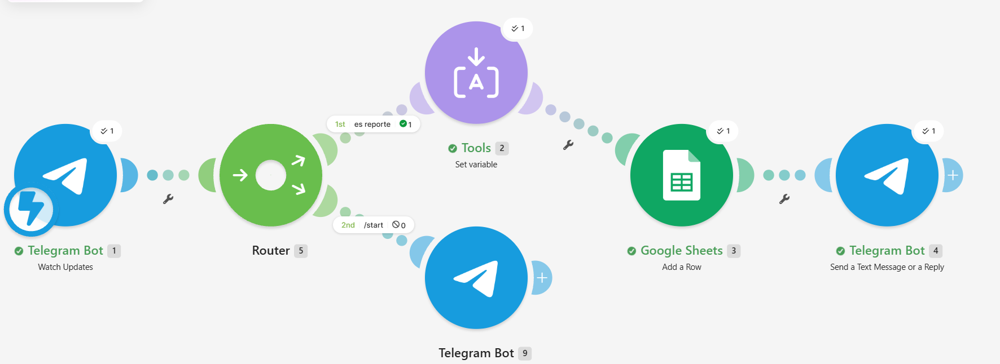

# Buzón ciudadano con folio – Equipo 67

Práctica 3.1-P4 · Desarrollo Sustentable (ACD-0908) · Ingeniería en Sistemas Computacionales
Unidad 3. Escenario socio-cultural · Tema 3.1 Sociedad, organización social

Buzón ciudadano automatizado en Telegram que recibe reportes ambientales, los registra en Google Sheets con fecha y usuario, y responde al ciudadano con un **folio** de seguimiento. Se construyó sin programar, con Telegram (BotFather), Make y Google Sheets.

## Contenido del repositorio

| Carpeta o archivo | Qué contiene |
| --- | --- |
| `index.html` | Página con el resumen del proyecto, el escenario, el video y los resultados |
| `codigo/` | Blueprint del escenario de Make (`Buzon_ciudadano_Equipo67_blueprint.json`) |
| `img/` | Imagen del escenario en Make (`escenario_make.png`) |
| `resultados/` | PDF con lo aprendido en la práctica |
| `video/` | Enlace al video de demostración |

## Cómo funciona

Flujo: **Telegram (Watch Updates) → Router → Set variable (folio) → Google Sheets (Add a Row) → Telegram (respuesta con folio)**

1. **Watch Updates** recibe cada mensaje que el ciudadano envía al bot.
2. El **Router** separa dos rutas:
   - Si el mensaje no empieza con `/` (ruta «es reporte»), se registra como reporte.
   - Si el mensaje es `/start`, el bot responde con las instrucciones de uso y no registra nada.
3. **Set variable** genera el folio con la hora local: `AMB-{{formatDate(now; "YYMMDD-HHmmss")}}`, por ejemplo `AMB-261028-153045`.
4. **Google Sheets** agrega una fila en la pestaña `Reportes` con las columnas: Folio, Fecha, Usuario, Nombre, Reporte y Estatus (`Recibido`).
5. **Telegram** responde al ciudadano con el folio y el estatus.

Formato de reporte que pide el bot: `Colonia - Problema`.

## Imagen del escenario

## Video

[Ver el video de demostración](https://youtu.be/QgJrhlcsVFY)

## Resultados

- [Lo que aprendí (PDF)](resultados/Lo_que_aprendi_Buzon_Ciudadano.pdf)

## Cómo reproducirlo

1. Crea una hoja de Google Sheets con una pestaña llamada `Reportes` y estos encabezados en la fila 1: `Folio, Fecha, Usuario, Nombre, Reporte, Estatus`.
2. Crea tu propio bot con **@BotFather** (`/newbot`) y guarda el token.
3. En Make, importa `codigo/Buzon_ciudadano_Equipo67_blueprint.json` (Create a new scenario → ··· → Import Blueprint).
4. Crea tu conexión de Telegram con tu token y tu conexión de Google, y elige tu hoja y la pestaña `Reportes` desde la lista desplegable. El blueprint trae el marcador `TU_ID_DE_GOOGLE_SHEETS` en lugar del ID de la hoja original.
5. Revisa que la zona horaria del perfil de Make sea `America/Mazatlan`.
6. Vincula el webhook del bot y activa el escenario (ON).

## Seguridad y privacidad

- **No se incluye ningún token.** El token del bot es la llave del bot: no lo compartas ni lo subas a GitHub.
- Los reportes no deben incluir datos personales de terceros; se describe el lugar con calle o referencia.

## Limitaciones

Es un registro con folio, todavía no un canal oficial: nadie responde ni actualiza el estatus, no hay plazos de respuesta, el ciudadano no puede consultar el avance de su reporte y el folio basado en la hora podría repetirse si dos reportes llegan en el mismo segundo.
